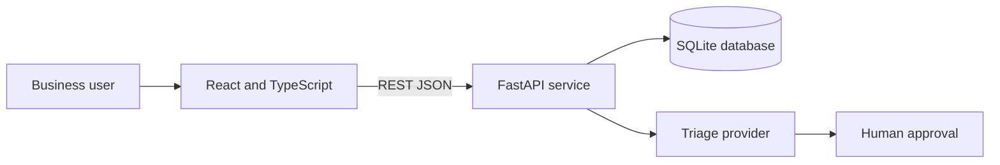

# OpsFlow Operations Request and Triage Pipeline

OpsFlow is a full-stack portfolio app that converts operational requests into accountable and reviewable work. It demonstrates how ambiguous business needs can be translated into a documented application with human-reviewed AI triage.

## What it demonstrates

- React and TypeScript user interface
- Python and FastAPI REST API
- SQLite persistence with an audit trail
- AI-assisted request classification with mandatory human approval
- Search, filtering, ownership, priority, and workflow status
- Backend integration tests
- GitHub Actions CI for backend tests and frontend builds
- Responsive interface designed for a real internal operations team

## Architecture



The application defaults to a deterministic local triage engine, so it runs without external credentials. If `OPENAI_API_KEY` is set, the backend requests a structured model recommendation. If that call fails, it automatically falls back to the local engine. In both cases, the recommendation remains unapproved until a person confirms or changes it.

## Quick start on Mac

Prerequisites: Python 3.12, Node.js 22 or newer, and npm.

1. Run `setup-mac.sh` once.
2. Run `start-mac.sh`.
3. Open <http://localhost:5173>.

## Manual setup

Run the backend and frontend in two separate Terminal windows or tabs. All commands start from the `Ops_Triage_Mac` folder.

### Backend

```bash
cd backend
python3.12 -m venv .venv
source .venv/bin/activate
pip install -r requirements-dev.txt
uvicorn app.main:app --reload
```

The API will be available at <http://127.0.0.1:8000>. Interactive API documentation is available at <http://127.0.0.1:8000/docs>.

### Frontend

```bash
cd frontend
npm install
npm run dev
```

The interface will be available at <http://localhost:5173>.

### Optional demo data

From the `Ops_Triage_Mac` folder, run:

```bash
cd backend
source .venv/bin/activate
python seed_demo.py
```

The seed script adds three realistic operational requests only when the database is empty.

## Optional model-based triage

In the Terminal window where you will start the backend, export these environment variables before running `uvicorn`:

```bash
export OPENAI_API_KEY=your_api_key
export OPENAI_MODEL=gpt-5-mini
```

These only last for that Terminal session. `start-mac.sh` opens new Terminal windows that won't inherit them, so start the backend manually when using model-based triage.

Never commit an API key. The `.gitignore` excludes `.env` files.

## API endpoints

| Method | Endpoint | Purpose |
|---|---|---|
| GET | `/api/health` | Service health check |
| GET | `/api/requests` | List and filter requests |
| POST | `/api/requests` | Create and automatically triage a request |
| GET | `/api/requests/{id}` | Get details and activity history |
| PATCH | `/api/requests/{id}` | Update ownership, status, or classification |
| POST | `/api/requests/{id}/approve-triage` | Confirm or correct the triage recommendation |
| GET | `/api/stats` | Dashboard summary metrics |

## Tests

From the `Ops_Triage_Mac` folder, run:

```bash
cd backend
source .venv/bin/activate
pytest -q
```

The integration test creates a request, validates automated triage, records human approval, assigns an owner, changes status, checks activity history, and verifies dashboard statistics.

## Design decisions and tradeoffs

- **SQLite first:** keeps the project easy to run while preserving a clean path to PostgreSQL.
- **Human-reviewed AI:** AI recommends; a person decides. This keeps accountability visible.
- **Local fallback:** the demonstration works without secrets, cost, or network access.
- **Simple authentication boundary:** authentication is intentionally excluded from version 1. A production version would add single sign-on and server-enforced roles.
- **Audit history:** meaningful changes are recorded so users can see who changed what and when.

## Responsible use of agentic coding

This project was developed with an agentic coding assistant. The problem definition, workflow, acceptance criteria, architecture review, testing, and documentation remain human responsibilities. Every important code path should be reviewed and explainable by the repository owner before it is presented in an interview.

## Suggested next improvements

- Add OpenID Connect login and role-based authorization
- Replace SQLite with PostgreSQL and database migrations
- Deploy the frontend and API to AWS
- Add structured logging, metrics, and alerting
- Add browser-based end-to-end tests
- Connect an enterprise source such as an ERP, HRIS, or quality system
- Add service-level targets and overdue-request notifications